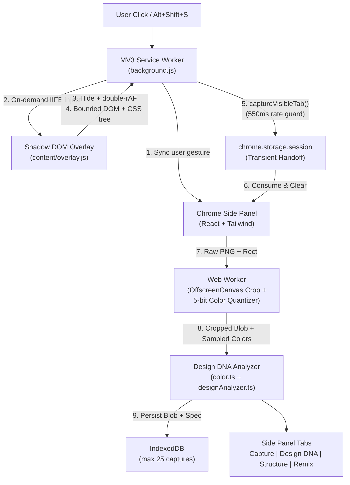

# StyleLens Architecture Blueprint

## 1. Design Goals & Non-Goals
- **Zero mandatory backend**: Everything runs inside the user's Chrome browser (Manifest V3).
- **Zero idle webpage overhead**: No static `content_scripts` injected at page load. The selection overlay is injected on-demand via `chrome.scripting.executeScript` only when invoked.
- **Honest provenance**: Every extracted token explicitly differentiates `exact-dom` (computed CSS) from `sampled-pixels` (Web Worker quantized screenshot pixels) and marks estimated WCAG contrast when gradients/images sit underneath text.
- **Offline-first & China-network resilient**: MVP delivers full capture, Design DNA extraction, WCAG auditing, token export, and AI Remix Prompt packaging with zero external network calls or API keys. Phase 4 snaps in Chrome Built-in AI (`LanguageModel`) and BYOK OpenAI-compatible endpoints (DeepSeek, Qwen/DashScope, Kimi, Ollama, OpenAI).

## 2. System Data Flow

## 3. Key Architectural Decisions (ADRs)

### ADR-01: On-Demand IIFE Content Script + Shadow DOM `adoptedStyleSheets`
- **Problem**: Static `<all_urls>` content scripts slow down every tab, bloat memory, and trigger broad install warnings. Inline `<style>` tags inside Shadow DOM can also trip strict host `style-src` CSP rules.
- **Decision**: Bundle `src/content/overlay.ts` into a zero-framework (~15 KB) IIFE (`dist/content/overlay.js`) injected exclusively via `chrome.scripting.executeScript`. Attach styles using Constructable Stylesheets (`new CSSStyleSheet()` -> `shadowRoot.adoptedStyleSheets`), which bypasses host-page `style-src` CSP and requires zero `web_accessible_resources`.

### ADR-02: Synchronous `sidePanel.open()` + Per-Origin `optional_host_permissions`
- **Problem**: `chrome.sidePanel.open()` throws if called after any `await` boundary. Meanwhile, `activeTab` is bound to the tab active at invocation time; switching tabs while the Side Panel stays open causes subsequent `executeScript` calls from inside the Side Panel to fail.
- **Decision**:
  1. Call `chrome.sidePanel.open({ windowId })` synchronously on `chrome.action.onClicked` and `chrome.commands.onCommand`.
  2. Keep install permissions minimal (`activeTab`, `scripting`, `sidePanel`, `storage`), and declare `optional_host_permissions: ["https://*/*", "http://*/*"]` so cross-tab captures from inside the Side Panel offer a one-click per-origin permission grant or fallback to `Alt+Shift+S`.

### ADR-03: Bitmap-Derived Crop Scale in a Dedicated Web Worker
- **Problem**: On Windows fractional DPI (125%, 150%) and zoomed tabs, multiplying CSS rects by `window.devicePixelRatio` causes 1–3 px crop drift; decoding and quantizing PNGs on the UI thread causes jank.
- **Decision**: Decode screenshots inside `imageProcessor.worker.ts` using `atob` -> `Blob` -> `createImageBitmap`, compute exact ratios `bitmap.width / viewport.width` and `bitmap.height / viewport.height`, crop via `OffscreenCanvas`, and run 5-bit quantized color extraction on a 72×72 downsampled buffer (< 3 ms).

### ADR-04: Modular `AIProvider` Interface (Zero-Backend, China-Ready)
- `src/ai/types.ts` defines a clean `AIProvider` contract with three pluggable engines:
  1. `DeterministicProvider` (always available offline — live token specimen preview, CSS/Tailwind/JSON export, and copy-paste AI prompts).
  2. `OpenAICompatibleProvider` (BYOK — DeepSeek, Qwen/DashScope, Moonshot Kimi, Google Gemini, OpenAI, OpenRouter, local Ollama, or custom OpenAI-compatible URL). Keys remain strictly in `chrome.storage.local`. Calling `chrome.permissions.request({ origins: [endpointOrigin] })` on user click grants per-origin host permission so Chrome Side Panel `fetch()` calls bypass CORS without broad install-time warnings or a backend proxy.
  3. `ChromeBuiltInProvider` (optional on-device Gemini Nano via `LanguageModel` inside the Side Panel document context — never auto-downloads weights and immediately destroys GPU sessions after generation).

### ADR-05: XSS-Proof Live Preview via `<iframe sandbox="" srcDoc>`
- **Problem**: Rendering AI-generated HTML inside an extension page carries XSS risk and violates MV3 CSP if external CDN scripts or inline JS are used.
- **Decision**: Instruct models to emit self-contained HTML + scoped `<style>` using extracted `--sl-*` CSS variables, sanitize away `<script>`, `<iframe>`, `javascript:`, and `on*=` attributes (`src/ai/responseParser.ts`), and render inside `<iframe sandbox="" srcDoc>` where JavaScript, forms, popups, and extension API access are disabled at the browser sandbox boundary.
